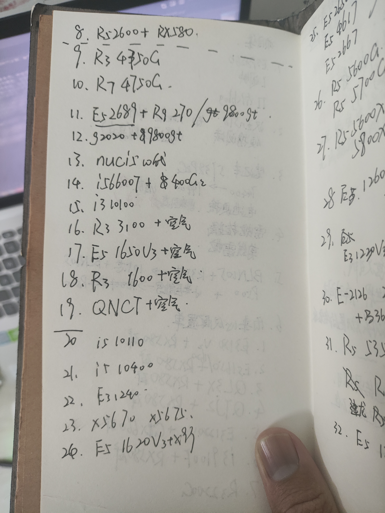
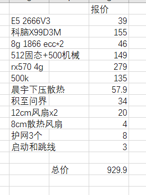
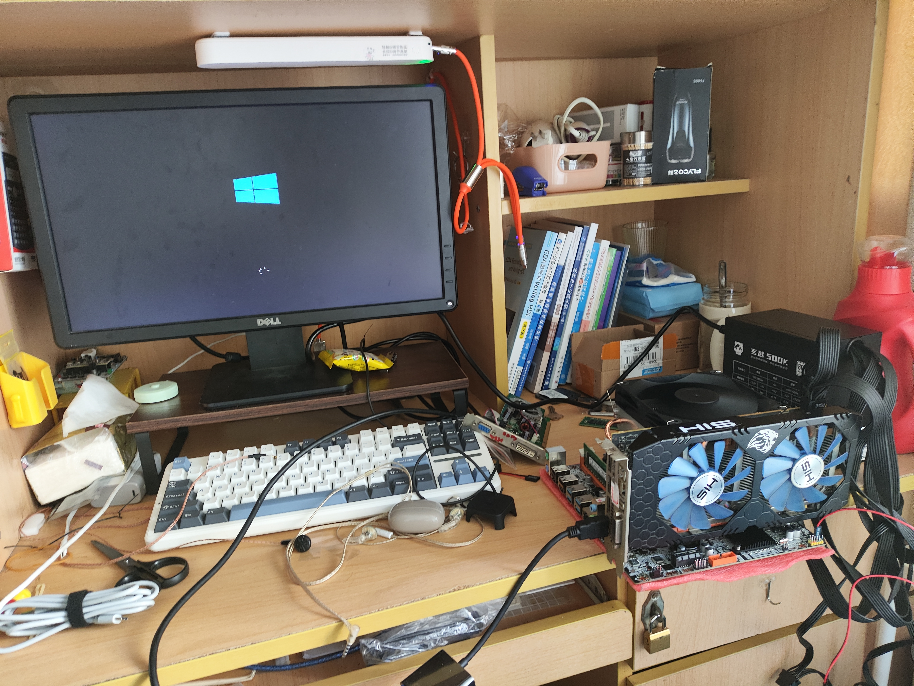
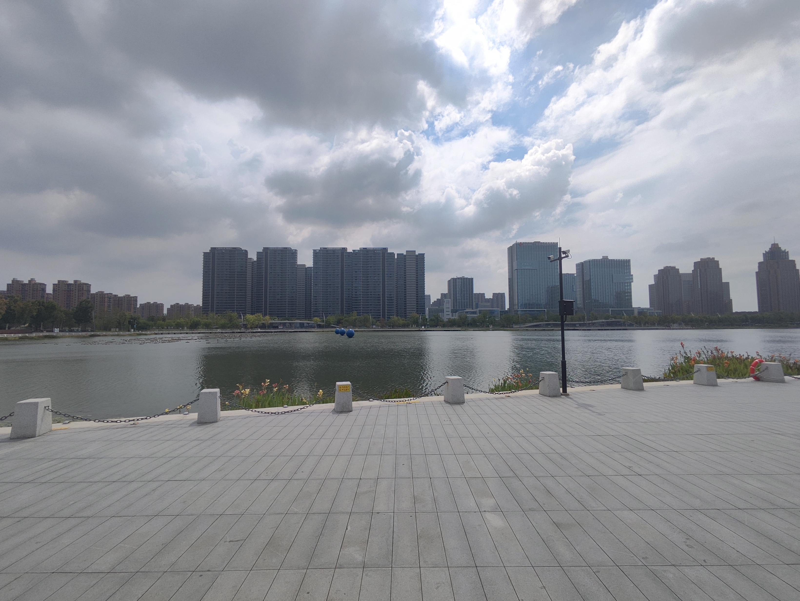
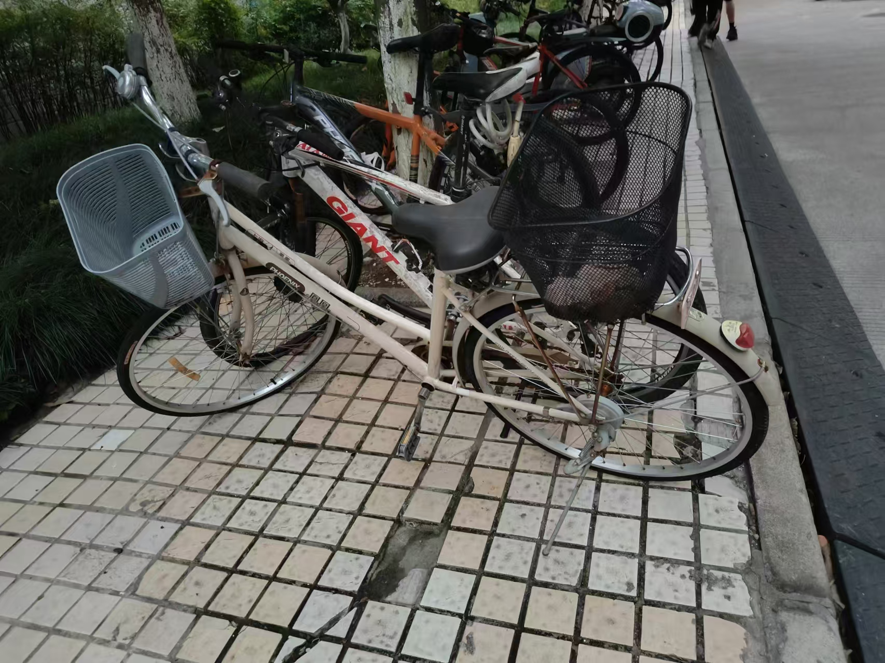
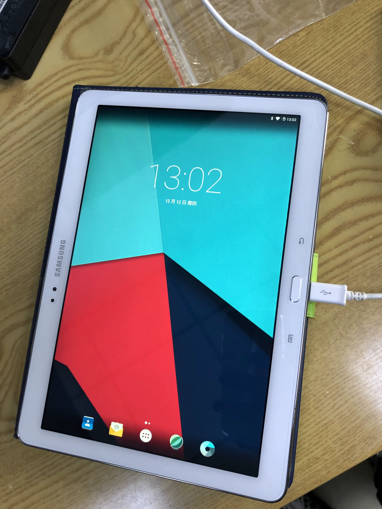

## 2024年除夕，这一年，我干了许多
&emsp;今年真的是除了我高三那一年以来干的大事最多的一年，虽然时到现在，我对这些不是很自豪和满足，但真到了这年尽头，回头看看，这一年真的干的好。干的漂亮。  

### 第一部分：驾照
&emsp;今年我考到了驾照，考了四次科目三之后终于拿到了，不用继续重蹈覆辙，高考之后大一最大的担忧就是这本证件。本来是2023年除夕前想拿到的结果不遂人愿。。。但好歹在寒假结束前拿到了，也算万幸。虽然很辛苦，但考完之后，感觉整个人都轻松了，因为我知道，我以后可以开车了，可以自己开车了，这对我以后的生活，工作，都有很大的帮助。  

### 第二部分：学习
&emsp;这一部分相较于驾照来说稍好一些，大一下的课程主要是自己把水课堆起来对冲gcd晚自习所以才忙了些，主要的内容是我通过这些水课，了解了一些内容，那些生活中需要必修课却不讲的一些内容，比如matlab，关于新闻发言人，关于论文的写作格式，怎么样才算写的符合规矩等等。这一年最大的选择还是两个：  
 1.选择哪个专业分流  
 2.是否加入wxd实验室  
&emsp;这两个选择的结果导向了整个后半年的学习方向与努力方向，最终，我选择了电子信息工程专业，尽管寝室里4个xd跟我选的不一样，但我还是选了这个，跟单片机更相关。 并且决心加入wxd实验室。这也就是为什么我有了这之后的种种暑假生活，还是非常有意义的。  
&emsp;关于绩点的话，绩点三个学期非常稳定的保持在了3.8。。。但是排名不一样，大一下排名靠前大二上还不知道。这一块不要太低就行了，之后必定要考研了，这部分不用说了。  
&emsp;介于9.3日之后我就没再更新过我的博客，我就把实验室生活这一部分内容写到这里，之后会继续更新。实验室给了我一个工位，自此，整个大二上学期我白天在寝室里的时间基本上就小于等于一个小时了，基本上是中午和网上回去拿瓶酸奶，拿本书，或者体育课上完洗个澡再过去，这个工位几乎占据了我所有的周末时光，虽然没有写博客，但是我可以痛苦且清楚的记得模电和信号两门专业课是如何将我的周末一天直接夺走的，非常恐怖，一做就是一个下午或者一个晚上，晚上不到10：20基本上不会回寝，周六那几天甚至十一点半才回去，卡着12点门禁回去，好在后面还算学的不戳。对的起自己的努力。但是很遗憾的一点在于，虽然身处实验室。跟实验室相关的东西却没有做多少。。。FreeRTOS那本书我只学完了理论，没学实践部分，这部分可能得下学期了。然后关于电赛的题目也基本上没做，H7更是没学，靠着寒假去赶工，唉，跨过一座大山，又得接着翻山越岭。不过话说回来，实验室里的人确实很好，真的有一种班级的感觉，或者用成人的话讲——同事？反正自大学以来，这可能是我除了室友以外唯一的关系圈了。这种共同为了一个相同目标而努力让我感觉又回到了过去的班级中。  
&emsp;其他成就的话，就是暑假的六级成绩和PCB成绩最让我高兴。哈哈。  

### 第三部分：自我项目
&emsp;终于到今年的重头戏了，今年真的尤其是大二上，真的搞了好多新项目都没来的及说啊，匆匆都过去了，没时间写个博客几年一下，先来重量级的：   

### 2024.11.2 我，装了，一台，主机
&emsp;我真的很难再想起我是什么时候开始想要组一台主机的，也许是2022寒假？或许更早，早到连X3440这种非常老的X58平台都在我的考虑范围内，750ti也不是不能接受，但这些终究都没有实现，成为了高中时代的一些残念。  
  这些残念随着现在手头这台笔记本的到来渐渐消散，但是配一台主机的想法始终一直在我脑海中有个概念，高考已过，笔记本也渐渐跟不上主流游戏需求了，因此我再次萌生了一个主机梦，我更需要一台能够在沉重学业之后上机就打的电脑，可能是二游，可能是3A，能够玩的爽就够了，于是在今年，我终于付出行动了。
  
  说实话，给装机”内行人”看估计会被喷死，基本上都是二手配件，但这的的确确是我的第一次装机生活。非常可贵，尤其是我看到点亮的一瞬间，真的感觉几年的酝酿没有白费，无数个夜晚想了怎么装机，怎么买配件，怎么装配件，万一矿卡有问题怎么办。。。点亮的那一刻，艺术已成。 通过这台造价不足一千的设备，我通关了黑神话，成功爽玩CS2。

### 2024.9.15 第一次在外地看病
 这一点可能看起来有点小儿科，但是放在当时看确实是一次很冒险的举动，当时是中秋节三天放假，由于暑假末期发现脖子上有个肿块，但是没时间去查了，本来是希望国庆的时候回wz去查一下的，但是我国庆不想回去，因此我的想法是自己去看一次病，先是去校医院转院，之后去了外面的医院挂号，医生给的答复是先拍个片看看，拍片时间在下午，当时就在旁边的公园逛逛。
  
  当时说实话是挺慌的，因为实在不清楚这个肿块到底是什么，如果麻烦可能还需要动小手术，不过最终结果是是个小肉包，没关系，直接坐车回去了，我还是非常感激自己的决定的，至少未来如果真的发生了一些难以异地就医的情况，我至少有了本地就医的经验。   

### 2024.9.21 我拥有了自己的一辆自行车
 其实从一开始来讲我本身是不太想买这辆车的，毕竟学校高峰段自行车电动车本身停放就很困难，然后行驶在人群中还不如走路，相比之下还是共享单车随骑随用方便，但是这一想法被高昂的月卡费用打破了，4个月120，我买一辆都没120，因此我最终从他人手中收购了一辆“小破烂”,这辆车刚开始真的是破烂，经过一个学期的休整，我换掉了握把套，后框，除了锈，并且还换了支架，勉强能用，又不是不能用。

### 2024.12.12 平板问题的最终解决
 这也是个老大难的问题，终于解决了，在经过多次比对价格，调试难度，并且在尝试数位板时仍然认为无法解决的情况下，我选择了三星的P600，处理器放现在是49年入清军了，但是基本的书写还是可以的，100米的书写体验能不好吗？，刷上安卓6+三星笔记，体验还是相当不错的。

### 2024 AI
老实说，你从上面可以看出来，这一年实际的物质实践干了不少，但是软件基本上没动过，很大程度上，AI已经融入生活了，文字有KIMI，解题有豆包，代码有codegeex，我没尝试的视频AI也基本上已经“傻瓜化”了，当然关于AI，今年最让我感到意外的是AI主播，纯粹的AI，neuro-sama 以及他的开发者vedal，在此之间，ai基本上是只能干一件事比较擅长，但是这个老哥调教出的模型确实非常厉害，可以一窥未来AI主播的雏形，并且最重要的一点，除非开发者暴雷，AI主播尤其是二次元皮套性质的AI主播，基本不会爆雷，毕竟他们没有所谓的“中之人”本质还是一堆代码。

## 2024总结
 2024年，我经历了许多事情，从暑假的脖子问题，到国庆的自行车，再到中秋的平板，以及年底的AI，这些经历让我成长了许多，也让我更加明白了生活的真谛。虽然这一年充满了挑战和困难，但是我相信只要我坚持不懈，勇往直前，我一定能够克服一切困难，迎接更加美好的未来。

